# Modèle de données

Schéma PostgreSQL 16 défini par les modèles SQLAlchemy (`services/api/app/models/`) et créé par les migrations `0001_initial_schema` et `0002_food_source_imports`. Un test d'intégration vérifie que modèles et migrations ne divergent pas.

```mermaid
erDiagram
    users ||--o| profiles : "a"
    users ||--o{ dietary_preferences : "déclare"
    users ||--o{ meals : "enregistre"
    users ||--o{ ai_predictions : "demande"
    users ||--o{ weight_logs : "pèse"
    users ||--o{ water_logs : "boit"
    users ||--o{ subscriptions : "souscrit"
    users ||--o{ consents : "consent"
    users ||--o{ recipes : "écrit"
    meals ||--|{ meal_items : "contient"
    meals }o--o| ai_predictions : "issu de"
    foods ||--o{ meal_items : "référencé par"
    recipes ||--|{ recipe_ingredients : "contient"
    foods ||--o{ recipe_ingredients : "référencé par"

    users {
        uuid id PK
        varchar email "unique, insensible à la casse"
        auth_provider auth_provider
        varchar password_hash "Argon2id, NULL si Apple/Google"
        varchar timezone "IANA, Europe/Paris"
        bool is_active
        timestamptz deletion_requested_at
    }
    profiles {
        uuid user_id PK,FK
        sex sex "santé"
        date birth_date "santé"
        numeric height_cm "santé"
        activity_level activity_level "santé"
        goal_type goal_type "santé"
        numeric target_weight_kg "santé"
        int kcal_target "santé, 1200 à 6000"
    }
    dietary_preferences {
        uuid id PK
        uuid user_id FK
        dietary_preference_kind kind
        varchar value "santé si allergie"
    }
    foods {
        uuid id PK
        varchar name "index trigramme"
        varchar barcode "unique, 8 à 14 chiffres"
        varchar ciqual_code "unique"
        food_source source
        numeric kcal_100g "0 à 900"
        numeric protein_100g
        numeric carbs_100g
        numeric fat_100g
        char nutriscore "a à e"
    }
    meals {
        uuid id PK
        uuid user_id FK
        meal_type meal_type
        timestamptz eaten_at
        meal_source source
        varchar photo_key "clé S3"
        uuid ai_prediction_id FK
    }
    meal_items {
        uuid id PK
        uuid meal_id FK
        uuid food_id FK "RESTRICT"
        numeric quantity_g "0 exclu à 5000"
        numeric kcal "copie figée"
        numeric ai_confidence "0 à 1"
        bool corrected
    }
    ai_predictions {
        uuid id PK
        uuid user_id FK
        varchar image_key
        varchar model_version
        prediction_status status
        jsonb predictions
        jsonb final_correction
    }
    weight_logs {
        uuid id PK
        uuid user_id FK
        date logged_on "unique par utilisateur"
        numeric weight_kg "santé, 20 à 400"
    }
    water_logs {
        uuid id PK
        uuid user_id FK
        date logged_on "unique par utilisateur"
        int volume_ml
    }
    subscriptions {
        uuid id PK
        uuid user_id FK
        subscription_platform platform
        varchar original_transaction_id "unique par plateforme"
        subscription_status status
        timestamptz current_period_end
    }
    consents {
        uuid id PK
        uuid user_id FK
        consent_type consent_type
        bool granted
        varchar version
    }
    recipes {
        uuid id PK
        uuid author_id FK "NULL = éditoriale"
        int servings
        bool is_public
    }
    recipe_ingredients {
        uuid id PK
        uuid recipe_id FK
        uuid food_id FK "RESTRICT"
        numeric quantity_g
    }
```

## Règles

| Règle | Mise en œuvre | Vérifiée par |
| --- | --- | --- |
| Identifiants non devinables et ordonnés | UUID v7 (`app/db/ids.py`) | `test_models.py`, `test_ids_are_uuid_v7` |
| Droit à l'effacement | Toutes les clés vers `users` en `ON DELETE CASCADE` | `test_every_reference_to_users_cascades_on_delete`, `test_deleting_a_user_deletes_all_their_data` |
| Historique figé | `meal_items` copie nom et nutriments à l'enregistrement | — (issue #25) |
| Un aliment utilisé n'est jamais supprimé | `ON DELETE RESTRICT` depuis `meal_items` et `recipe_ingredients` | `test_referenced_food_cannot_be_deleted` |
| Valeurs plausibles | Contraintes `CHECK` (poids 20-400 kg, quantité > 0, Nutri-Score a-e…) | tests d'intégration |
| Consentements traçables | `consents` en ajout seul, consentement courant = ligne la plus récente | — (issue #17) |
| Données de santé identifiées | `info={"health_data": True}` sur 12 colonnes | `test_health_data_columns_are_marked` |
| Provenance des aliments tracée | Table `food_source_imports` : source, version, licence, volumes, rejets par motif (hors diagramme, sans lien avec les utilisateurs) | `test_import_is_idempotent_and_traced` |
| Données analytiques isolées | Schéma `analytics` séparé (vide pour l'instant) | migration 0001 |

## Données de santé et chiffrement

Les colonnes marquées « santé » seront chiffrées au niveau colonne par l'issue #36. Une fois chiffrées, la base ne pourra plus vérifier leurs bornes : les contraintes `CHECK` correspondantes (`profiles.*`, `weight_logs.weight_kg`) seront alors déplacées dans la validation applicative par la même migration.

## Conventions

Tables au pluriel en `snake_case`, horodatages `timestamptz` en UTC, noms de contraintes générés (`pk_`, `fk_`, `uq_`, `ck_`, `ix_`) : voir `docs/conventions.md` §7.
