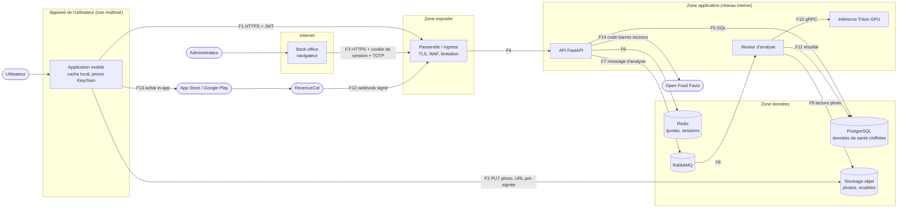

# Modèle de menaces — FoodAnalyser

| | |
| --- | --- |
| Méthode | STRIDE par élément du diagramme de flux de données, puis scénarios d'abus |
| Référentiels | OWASP MASVS 2 (L1, et L2 pour le stockage), OWASP API Security Top 10 2023 |
| Version | 1.0 — 5 novembre 2026 (milestone M1) |
| Prochaine revue | Fin de M2 (MVP), puis à chaque milestone et à chaque nouveau flux de données |
| Issue | #14 |

## 1. Ce qu'on protège

| Actif | Pourquoi c'est sensible | Niveau |
| --- | --- | --- |
| Données de santé : poids, objectifs, profil, allergies, journal alimentaire | Article 9 du RGPD ; révèlent l'état de santé, parfois un trouble alimentaire | Critique |
| Photos de repas | Peuvent contenir la position GPS (EXIF), des visages, l'intérieur du domicile | Élevé |
| Comptes et sessions | Donnent accès à tout ce qui précède | Élevé |
| Comptes administrateur | Modifient la base d'aliments pour tous, voient les statistiques | Élevé |
| Modèle d'IA et jeu d'entraînement | Actif principal du produit ; un modèle empoisonné donne de mauvaises calories à tous | Élevé |
| Capacité GPU | Coût direct par analyse | Moyen |
| Abonnements | Revenu ; fraude = perte directe | Moyen |
| Base d'aliments | Sous licence ODbL ; erreurs = mauvaises valeurs pour tous | Moyen |

## 2. Diagramme de flux de données

Frontières de confiance : **Z0** (l'appareil appartient à l'utilisateur, il peut être rooté, l'application décompilée, le trafic intercepté), **Z1 → Z2** (tout ce qui vient d'Internet est hostile jusqu'à preuve du contraire), **Z2 → Z3**, **Z3 → Z4** (seuls les services applicatifs parlent aux données).

| Flux | Données | Authentification | Ce qui traverse une frontière |
| --- | --- | --- | --- |
| F1 | Repas, poids, profil | JWT 15 min + refresh token rotatif | Z0 → Z2 |
| F2 | Photo brute | URL pré-signée PUT, 5 min, 10 Mo | Z0 → Z4 directement |
| F3 | Base d'aliments, contenus | Cookie `HttpOnly` + TOTP | Z1 → Z2 |
| F7-F8 | Identifiants (utilisateur, upload) | Réseau interne + identifiants RabbitMQ | Z3 → Z4 → Z3 |
| F12 | Événements d'abonnement | Secret partagé dans l'en-tête | Internet → Z2 |
| F14 | Code-barres (chiffres uniquement) | — (API publique) | Z3 → Internet |

## 3. Analyse STRIDE

Niveau = probabilité × impact, sur trois niveaux. Les menaces **élevées** ont toutes un contrôle et une issue (section 5).

| ID | Élément | STRIDE | Menace | Niveau | Contrôles | Issues |
| --- | --- | --- | --- | --- | --- | --- |
| T-01 | F1, API | S | Vol de compte par bourrage d'identifiants ou mot de passe faible | Élevé | Argon2id, vérification HIBP, 5 essais / 15 min, MFA administrateur | #15, #37 |
| T-02 | API | S | Jeton JWT forgé (`alg: none`, confusion RS256/HS256) | Élevé | Liste blanche d'algorithmes, `aud` / `iss` / `exp` vérifiés, clés hors du code | #15, #36 |
| T-03 | API | S | Refresh token volé puis rejoué | Élevé | Rotation à chaque usage, détection de réutilisation → révocation de toute la famille | #15 |
| T-04 | API | S | `id_token` Apple / Google d'une autre application accepté | Moyen | Vérification de `aud`, `iss`, `nonce`, JWKS en cache | #15 |
| T-05 | API, PG | I | **IDOR** : lire ou modifier le repas, le poids ou la photo d'un autre utilisateur | Élevé | Contrôle d'appartenance sur chaque route, 404 et non 403, UUID v7 non devinables, test automatique sur toutes les routes | #25, #37 |
| T-06 | API | T | Assignation de masse (`is_premium`, `user_id` dans le corps) | Élevé | Schémas Pydantic `extra="forbid"`, champs sensibles jamais lus du client | #37 |
| T-07 | F2, S3, W | T, E | Upload malveillant : faux JPEG, image polyglotte, bombe de décompression | Élevé | Type et taille imposés par l'URL pré-signée, octets magiques, `Image.verify`, réencodage, `MAX_IMAGE_PIXELS` | #20 |
| T-08 | F2, S3 | I | Photo avec position GPS ou visages réutilisée ou fuitée | Élevé | Suppression EXIF au réencodage, bucket privé, suppression à 90 jours, floutage des visages avant entraînement | #3, #12, #20 |
| T-09 | API | I | Fuite d'information dans les erreurs (pile, SQL, hôte, mot de passe) | Moyen | Erreurs `problem+json` sans détail, valeurs saisies non renvoyées en 422 | #4 (fait) |
| T-10 | Logs | I | Données de santé ou jetons dans les logs, Sentry ou traces | Élevé | Logs JSON sans chaîne de requête ni corps, `SecretStr`, filtrage Sentry | #4 (fait), #53 |
| T-11 | API, T | D | **Abus du quota gratuit** : multi-comptes ou client scripté, coût GPU | Élevé | Quota par compte et par appareil, attestation App Attest / Play Integrity, e-mail vérifié | #23, #75 |
| T-12 | API, GW | D | Saturation aux heures de repas ou par requêtes coûteuses | Moyen | Limitation par route, taille de corps 1 Mo, file asynchrone, autoscaling, tests de charge | #37, #54, #58 |
| T-13 | MQ, W | T, D | Message d'analyse malformé qui bloque le worker | Moyen | Schéma de message validé, file d'erreurs (DLQ), délai maximal, réseau interne seulement | #23, #58 |
| T-14 | Appareil (Z0) | I | **Données de santé lisibles sur le téléphone** : cache en clair, aperçu du sélecteur d'apps, notifications, sauvegardes cloud | Élevé | MMKV chiffré + clé Keychain, masquage en arrière-plan, notifications génériques, exclusion des sauvegardes | #7, #76 |
| T-15 | F1 | I, T | Interception TLS (Wi-Fi public, certificat racine installé) | Moyen | TLS 1.3, épinglage de la clé publique | #16, #58 |
| T-16 | F12 | S, T | Faux webhook d'abonnement ou rejeu pour obtenir le premium | Élevé | Secret vérifié, traitement idempotent, droits calculés côté serveur uniquement | #32 |
| T-17 | Appareil | T | Application modifiée qui se déclare premium | Moyen | Aucun droit décidé par le client : l'API vérifie l'abonnement à chaque requête coûteuse | #32 |
| T-18 | W, modèle | T | **Empoisonnement du jeu d'entraînement** par des corrections volontairement fausses | Élevé | Voir scénario A-6 | #17, #51 |
| T-19 | BO | S, E | Compte administrateur compromis | Élevé | TOTP obligatoire, sessions courtes, RBAC, accès par VPN / liste d'IP, journal d'audit | #34 |
| T-20 | BO | T | XSS ou CSRF dans le back-office (champ « nom d'aliment » malveillant) | Moyen | Échappement React, CSP stricte, cookie `SameSite=Strict`, jeton CSRF | #8 (fait en partie), #34, #37 |
| T-21 | BO | R | Un administrateur nie avoir modifié un aliment | Moyen | `admin_audit_logs` avant / après, non modifiable par les administrateurs | #34 |
| T-22 | API | R | Un utilisateur conteste avoir donné son consentement | Moyen | Table `consents` en ajout seul, version du texte, horodatage | #5 (fait), #17 |
| T-23 | PG, sauvegardes | I | Vol d'une sauvegarde ou d'un dump de base | Élevé | Chiffrement des colonnes de santé (clé hors base), sauvegardes chiffrées, effacement cryptographique | #36, #58 |
| T-24 | Chaîne d'approvisionnement | T, E | Dépendance ou action CI compromise (cf. trivy-action, mars 2026) | Élevé | Actions épinglées par SHA, délai de 7 jours (pnpm, Dependabot), `trustPolicy`, Trivy, Semgrep, gitleaks | #2 (fait) |
| T-25 | API | I | Énumération des comptes via inscription ou mot de passe oublié | Moyen | Réponses identiques, e-mail envoyé dans les deux cas, limitation | #15 |
| T-26 | F14 | I | Requête sortante détournée (SSRF) via le code-barres | Faible | Code-barres validé (chiffres, clé de contrôle), URL fixe, délai de 2 s | #27 |
| T-27 | Assistant IA (V2) | T, I | Injection de prompt : conseil dangereux ou fuite de données d'un autre utilisateur | Élevé | Contexte limité à l'utilisateur courant, garde-fous en entrée et en sortie, jeu d'évaluation | #65 |
| T-28 | Base d'aliments | T | Valeurs nutritionnelles fausses importées (source modifiée, colonne décalée) | Moyen | Validation par motif, colonnes vérifiées avant écriture, traçabilité des imports, contrôle kcal ≈ 4P + 4G + 9L | #6, #35 |
| T-29 | PG, S3, MQ | E | Accès direct aux données depuis un autre pod ou Internet | Élevé | Réseau interne, network policies « tout refuser », comptes de service distincts, ports locaux en dev | #3 (fait), #58 |
| T-30 | Secrets | I | Secret commité ou présent dans une image | Élevé | gitleaks (pre-commit et CI, historique complet), `.env` ignorés, gestionnaire de secrets | #1, #2 (fait), #36 |

## 4. Scénarios d'abus

### A-1 · Lire le journal d'un autre utilisateur (IDOR)

> L'attaquant intercepte `GET /api/v1/meals/0193a1b2-…` avec son propre jeton et remplace l'identifiant par celui d'un autre repas (vu dans un partage, deviné, ou récupéré par énumération).

- **Contrôles** : chaque requête filtre par `user_id = sub du jeton` ; un repas d'un autre renvoie **404** (pas 403, qui confirmerait l'existence) ; UUID v7 avec 74 bits aléatoires ; test automatique qui parcourt toutes les routes `/{id}` avec un second utilisateur (#37).
- **Détection** : pic de 404 sur des identifiants valides pour un même compte (#53).

### A-2 · Téléverser un fichier piégé

> L'attaquant demande une URL pré-signée puis envoie un script PHP renommé en `.jpg`, une image polyglotte JPEG/HTML, ou une image de 50 000 × 50 000 pixels.

- **Contrôles** : `Content-Type` et taille maximale fixés dans la signature ; le worker vérifie les octets magiques, décode avec Pillow (`MAX_IMAGE_PIXELS` défini), **réencode** en JPEG (ce qui détruit tout contenu caché), supprime l'original ; aucune photo n'est jamais servie depuis un domaine de l'application (#20).

### A-3 · Énumérer les comptes

> L'attaquant soumet une liste d'e-mails à l'inscription ou au mot de passe oublié pour savoir qui utilise une application de régime.

- **Contrôles** : même réponse et même temps de réponse que le compte existe ou non ; l'information passe par l'e-mail envoyé (« vous avez déjà un compte ») ; limitation par IP et par e-mail (#15). Le simple fait d'être inscrit est une donnée sensible ici.

### A-4 · Contourner le quota gratuit

> L'attaquant crée 50 comptes avec des adresses jetables, ou appelle `/meals/analyze` depuis un script pour utiliser gratuitement le modèle.

- **Contrôles** : e-mail vérifié avant la première analyse ; quota par compte **et** par appareil attesté ; attestation App Attest / Play Integrity sur les routes coûteuses ; limite de comptes par appareil et par IP (#75). Tant que #75 n'est pas livrée, la limitation par IP (#37) et l'alerte sur le coût GPU (#53) réduisent l'exposition.

### A-5 · Obtenir le premium sans payer

> L'attaquant modifie l'application pour qu'elle se croie premium, ou rejoue un webhook RevenueCat capturé.

- **Contrôles** : les droits sont calculés par l'API à partir de `subscriptions`, jamais déclarés par le client ; le webhook exige le secret partagé ; traitement idempotent par identifiant d'événement ; un rejeu ne change rien (#32).

### A-6 · Empoisonner le modèle par les corrections

> Un groupe d'utilisateurs corrige systématiquement « salade » en « pizza » (ou l'inverse) pour dégrader le modèle, ou pour pousser une marque.

- **Contrôles définis** (#51, #17) :
  1. Seules les corrections avec consentement `ai_training` sont exportées.
  2. **Aucune correction n'entre dans le jeu sans validation humaine** ; la file de modération est priorisée par classe, pas par volume d'un utilisateur.
  3. Quota de corrections exportables par utilisateur et par jour ; comptes récents ou non vérifiés exclus.
  4. Détection d'utilisateurs aberrants : taux de désaccord avec le consensus des autres utilisateurs et des annotateurs.
  5. Chaque version de jeu est figée (DVC) : on peut retirer les contributions d'un compte et réentraîner.
  6. Un nouveau modèle moins bon que le précédent sur le **jeu de test figé** (jamais alimenté par les utilisateurs) est refusé automatiquement ; déploiement progressif à 10 % avec suivi du taux de correction.

### A-7 · Prendre le contrôle d'un compte administrateur

> L'attaquant hameçonne un éditeur nutrition et modifie les calories de produits courants.

- **Contrôles** : TOTP obligatoire, back-office accessible seulement par VPN ou liste d'IP, rôle minimal (un analyste ne modifie rien), journal d'audit avant / après, historique des versions d'un aliment pour revenir en arrière (#34, #35).

### A-8 · Lire les données de santé d'un téléphone perdu ou sauvegardé

> Le téléphone est déverrouillé un instant par un proche, ou une sauvegarde iCloud est restaurée sur un autre appareil.

- **Contrôles** : cache chiffré par une clé « cet appareil uniquement », exclu des sauvegardes ; écran masqué dans le sélecteur d'applications ; notifications sans chiffres (#76).

## 5. Matrice des contrôles

### OWASP API Security Top 10 2023

| Risque | Menaces | État | Issues |
| --- | --- | --- | --- |
| API1 — Autorisation au niveau objet | T-05 | À faire (UUID v7 déjà en place) | #25, #37 |
| API2 — Authentification défaillante | T-01 à T-04, T-25 | À faire | #15 |
| API3 — Autorisation au niveau propriété | T-06 | À faire | #37 |
| API4 — Consommation illimitée de ressources | T-07, T-11, T-12 | À faire | #20, #37, #75 |
| API5 — Autorisation au niveau fonction | T-19 | À faire | #34 |
| API6 — Accès non restreint aux flux métier sensibles | T-11, T-16 | À faire | #32, #75 |
| API7 — SSRF | T-26 | À faire | #27 |
| API8 — Mauvaise configuration de sécurité | T-09, T-29 | **Fait en partie** : erreurs sans détail, docs coupées en production, CORS restreint, ports locaux, conteneur non-root | #3, #4, #37, #58 |
| API9 — Inventaire mal géré | — | **Fait en partie** : API versionnée `/api/v1`, OpenAPI généré | #4 |
| API10 — Consommation non sûre d'API tierces | T-16, T-26, T-28 | À faire | #6, #27, #32 |

### OWASP MASVS 2

| Groupe | Niveau visé | Exigence clé | État | Issues |
| --- | --- | --- | --- | --- |
| MASVS-STORAGE | L2 | Aucune donnée sensible en clair sur l'appareil ni dans les sauvegardes | À faire | #7, #76 |
| MASVS-CRYPTO | L1 | Algorithmes et clés de la plateforme (Keychain / Keystore) | À faire | #16, #76 |
| MASVS-AUTH | L1 | Session côté serveur, jetons révocables, déconnexion effective | À faire | #15, #16 |
| MASVS-NETWORK | L1 | TLS partout, épinglage de la clé de l'API | À faire | #16 |
| MASVS-PLATFORM | L1 | Permissions minimales (caméra), écran masqué, deep links validés | À faire | #24, #31, #76 |
| MASVS-CODE | L1 | Dépendances à jour, entrées validées | **Fait** pour la chaîne d'approvisionnement | #2 |
| MASVS-RESILIENCE | — (hors périmètre V1) | Attestation d'intégrité seulement pour la lutte contre l'abus | À faire | #75 |
| MASVS-PRIVACY | L1 | Minimisation, consentement, transparence | À faire | #17, #33, #59 |

### Contrôles déjà en place

| Contrôle | Où | Menaces |
| --- | --- | --- |
| Identifiants UUID v7 non devinables | `app/db/ids.py` | T-05 |
| Suppression en cascade de toutes les données d'un utilisateur, testée | migration 0001 | RGPD, T-23 |
| Données de santé marquées colonne par colonne (prêtes pour le chiffrement) | `app/models/` | T-23 |
| Erreurs `problem+json` sans détail technique ni valeur saisie | `app/core/errors.py` | T-09 |
| Logs sans chaîne de requête, `X-Request-ID` filtré contre l'injection | `app/core/middleware.py` | T-10 |
| URL de connexion en `SecretStr`, obligatoires, jamais par défaut | `app/core/config.py` | T-30 |
| CORS explicite, `*` refusé en production, docs coupées en production | `app/main.py` | T-29 |
| Back-office sans jeton en JavaScript, toutes les routes protégées | `apps/backoffice` | T-19, T-20 |
| Ports Docker sur 127.0.0.1, bucket privé, conteneur non-root | `infra/docker` | T-29 |
| Actions CI épinglées par SHA, délai de 7 jours, `trustPolicy`, gitleaks, Semgrep, Trivy | `.github/`, `pnpm-workspace.yaml` | T-24, T-30 |
| Import d'aliments validé, colonnes vérifiées avant écriture, tracé | `app/importers/` (#6) | T-28 |

## 6. Hors périmètre et risques acceptés

| Sujet | Décision |
| --- | --- |
| Détection du jailbreak / root | Non bloquante en V1 : bloquer pénaliserait des utilisateurs légitimes ; l'attestation (#75) couvre l'abus |
| Obfuscation du code mobile | Hors périmètre : aucun secret dans l'application, les droits sont vérifiés côté serveur |
| Attaques physiques sur l'infrastructure | Déléguées à l'hébergeur certifié (HDS si coaching, #58) |
| Déni de service volumétrique (couche réseau) | Délégué à la protection anti-DDoS de l'hébergeur |

## 7. Tenir le modèle à jour

- **À chaque PR** qui ajoute un flux de données, un service tiers ou un type de donnée personnelle : mettre à jour le diagramme et la table STRIDE (case dans le modèle de PR).
- **À chaque fin de milestone** : revue complète, mise à jour des colonnes « État » et du niveau des menaces.
- **Avant le pentest (#56)** : ce document sert de périmètre et de liste de vérification aux auditeurs.
